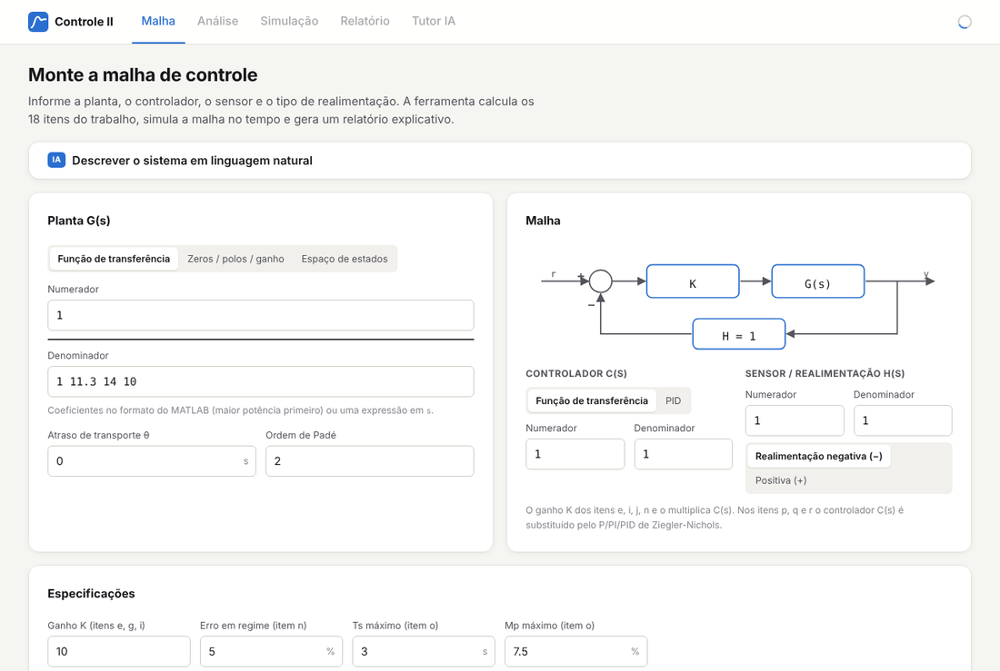
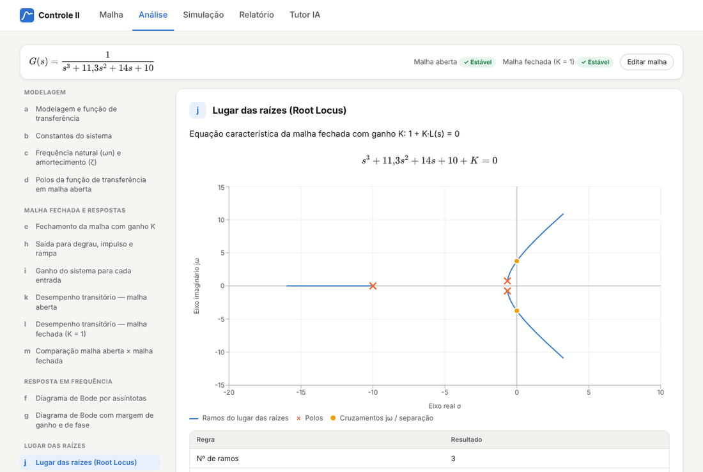
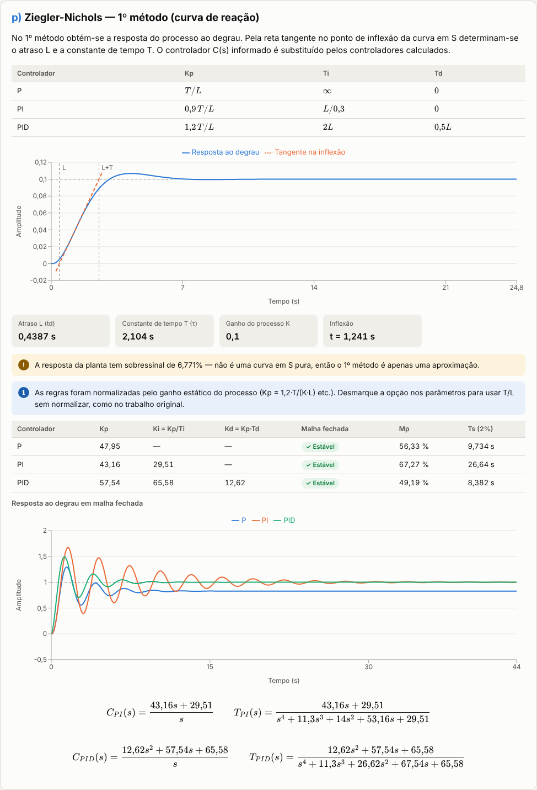
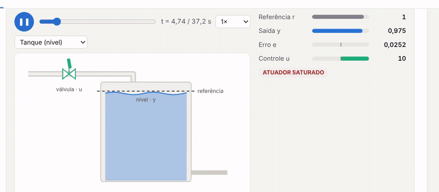
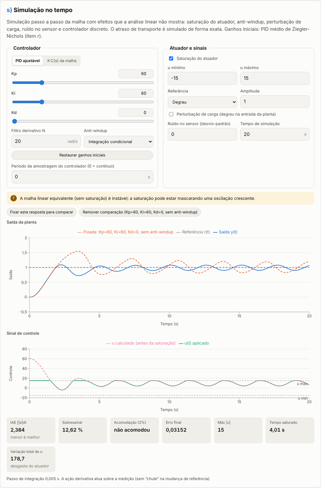
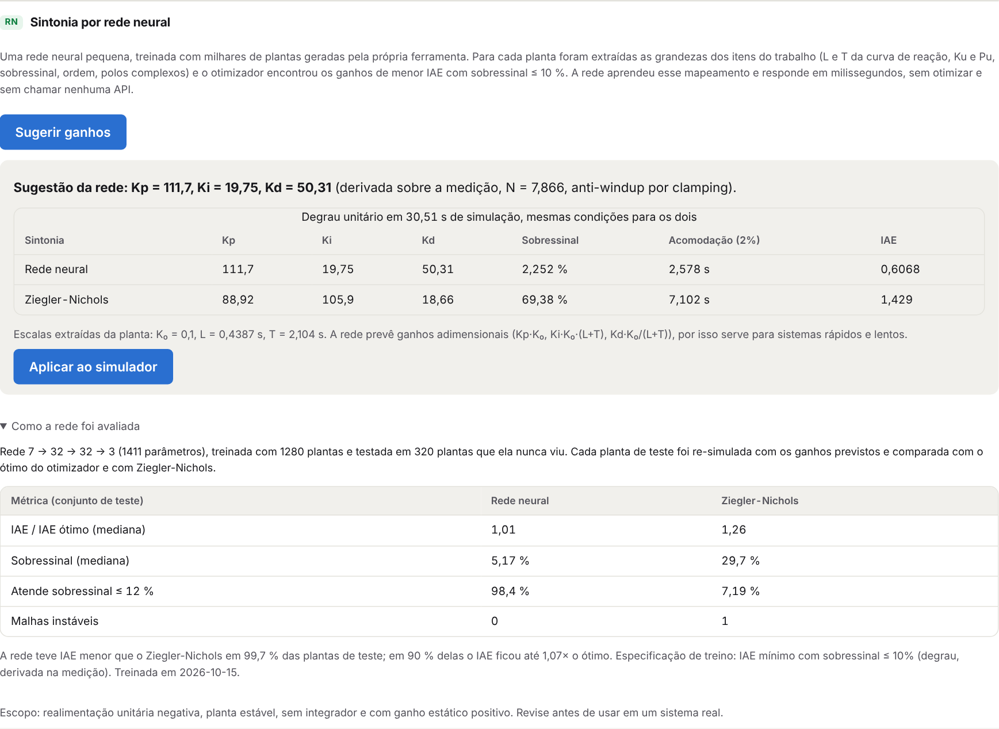
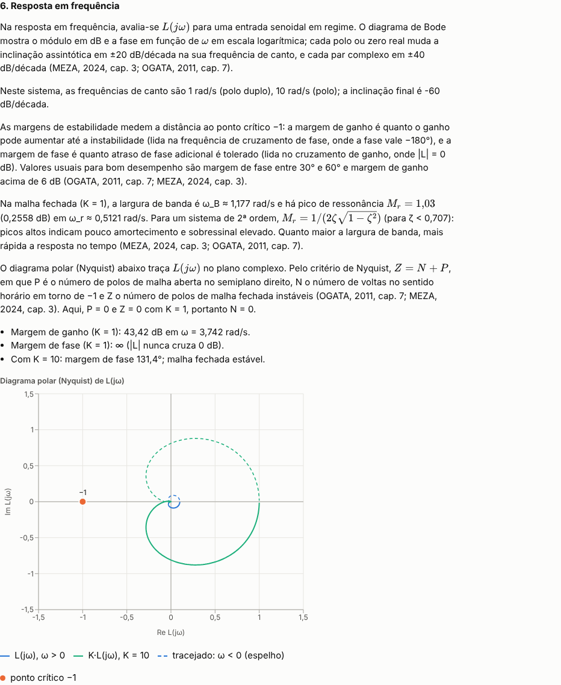

# Controle II — Análise de Sistemas

**Uma ferramenta web para estudar sistemas de controle clássico.** Você descreve uma malha de controle — a
planta, o controlador, o sensor e o tipo de realimentação — e a ferramenta calcula e explica, passo a passo,
tudo o que normalmente se faz à mão ou no MATLAB em uma disciplina de Controle: função de transferência,
polos e estabilidade, resposta ao degrau, diagramas de Bode, margens, lugar das raízes, erro em regime,
projeto de ganho e sintonia de PID por Ziegler-Nichols. No final, gera um relatório explicativo com base em
livros de referência da área.



🎬 **[Veja a simulação animada em ação](#simulação-no-tempo)** · [vídeo de 1 minuto](docs/video/controle2-simulacao-animada.mp4)

## Por que existe

A ferramenta nasceu de um trabalho de Controle II de um curso de Engenharia Mecatrônica (2013). Nele, uma
planta de 3ª ordem foi analisada em 18 itens (a até r) com MATLAB e SIMULINK. Este projeto transforma aquele
roteiro em uma aplicação que funciona **para qualquer sistema**: em vez de reescrever scripts para cada
planta, basta informar a malha e todos os itens são recalculados, com gráficos, fórmulas e interpretação.

Ela é útil para:

- **estudantes**, que podem conferir exercícios, ver o efeito de cada parâmetro e entender o porquê de cada
  resultado;
- **professores**, para gerar exemplos e gabaritos rapidamente;
- **quem precisa de uma análise rápida** de uma malha SISO sem ter MATLAB instalado.

## Como funciona

```
 r ──►(Σ)──► K·C(s) ──► G(s)·e^(−θs) ──┬──► y
       ▲ ∓                             │
       └────────── H(s) ◄──────────────┘
```

A interface é dividida em abas: **Malha** (montagem do sistema), **Análise** (os 18 itens, agrupados por tema
e mostrados um de cada vez), **Simulação** (simulação no tempo com animação), **Relatório** e **Tutor IA**.

1. **Monte a malha.** Informe a planta **G(s)** (função de transferência, zeros/polos/ganho ou espaço de
   estados), um **atraso** opcional, o **controlador C(s)** (função de transferência ou PID), o **sensor H(s)**
   e se a realimentação é **negativa ou positiva**. Polinômios aceitam o formato do MATLAB (`1 11.3 14 10`) ou
   expressões em `s` (`(s+10)(s^2+1.3s+1)`).
2. **Defina as especificações**, como o ganho K, o erro em regime desejado e os limites de tempo de acomodação
   (Ts) e sobressinal (Mp).
3. **Clique em "Analisar malha".** O backend calcula os 18 itens e o relatório; o frontend mostra cada item
   com fórmulas, tabelas e gráficos interativos.
4. **Simule** a malha no tempo, ajustando os ganhos do PID e acrescentando saturação, perturbação e ruído.
5. **Leia o relatório final** e, se quiser, **converse com o tutor de IA** sobre os resultados.



## O que a ferramenta calcula

| Item | O que mostra |
|---|---|
| **a** | Equação diferencial, transformada de Laplace, função de transferência, espaço de estados e as funções de malha aberta L(s) e fechada T(s) |
| **b** | Coeficientes, ordem, tipo, ganho estático e resposta ao degrau da planta |
| **c** | Fatoração do denominador e frequência natural ωn e amortecimento ζ de cada fator de 2ª ordem |
| **d** | Polos, zeros, estabilidade em malha aberta e tabela de Routh-Hurwitz |
| **e** | Malha fechada com ganho K: função de transferência, polos e resposta ao degrau |
| **f** | Diagrama de Bode por assíntotas (frequências de canto e inclinações) comparado à curva exata |
| **g** | Bode com margem de ganho e margem de fase |
| **h** | Respostas a degrau, impulso e rampa em malha aberta e fechada, com o erro em regime |
| **i** | Ganho para cada tipo de entrada, constantes de erro Kp, Kv, Ka e faixa de K que mantém a malha estável |
| **j** | Lugar das raízes: assíntotas, pontos de separação, ângulos de partida, cruzamento com o eixo jω e Routh em função de K |
| **k / l** | Desempenho transitório (tempo de subida, de pico, de acomodação e sobressinal) em malha aberta e fechada — pela fórmula e medido na simulação |
| **m** | Comparação entre malha aberta e fechada no mesmo gráfico |
| **n** | Ganho proporcional para um erro em regime especificado, avisando se ele desestabiliza a malha |
| **o** | Ganho proporcional para atender Ts e Mp: polos desejados, condição de ângulo e varredura de K |
| **p** | Ziegler-Nichols, 1º método (curva de reação): controladores P, PI e PID |
| **q** | Ziegler-Nichols, 2º método (ganho crítico Ku e período Pu): controladores P, PI e PID |
| **r** | Média dos parâmetros dos dois métodos e simulação para degrau, rampa e senoide |

<p align="center">
  
</p>

### Simulação no tempo

A seção **s) Simulação no tempo** integra a malha passo a passo e mostra o que a análise linear não mostra:

- **saturação do atuador** e **anti-windup** (integração condicional ou *back-calculation*);
- **perturbação de carga** na entrada da planta e **ruído no sensor**;
- **controlador discreto**, com período de amostragem próprio;
- **atraso de transporte exato**, simulado com um buffer de amostras em vez da aproximação de Padé;
- referência em degrau, onda quadrada, rampa ou senoide.

A simulação pode ser **animada**: um botão de reprodução (com velocidade ajustável e barra de tempo) mostra a
malha evoluindo em uma vista física — **tanque** (nível = saída, válvula = sinal de controle), **carrinho**
(posição e força) ou **motor** (ângulo e torque) —, com medidores de r, y, erro e u, indicação de saturação e um
cursor que percorre os gráficos.

<p align="center">
  <a href="docs/video/controle2-simulacao-animada.mp4">
    
  </a>
</p>

▶️ **[Assista ao vídeo completo (1 min)](docs/video/controle2-simulacao-animada.mp4)** — da montagem da malha à
comparação com e sem anti-windup.

Os ganhos Kp, Ki e Kd são ajustados por *sliders* e o gráfico é recalculado na hora. Dá para fixar uma resposta e
compará-la com outra, por exemplo com e sem anti-windup. A simulação mostra a saída, o sinal de controle (antes e
depois da saturação) e métricas como IAE, sobressinal, tempo de acomodação, recuperação após a perturbação, tempo
em saturação e variação total do sinal de controle. Ela também avisa quando a malha diverge ou quando a saturação
está mascarando uma malha linear instável.

O controlador segue a forma paralela do bloco **PID Controller do Simulink**: `Kp + Ki/s + Kd·N·s/(s + N)`,
com N = 100 e a derivada sobre o erro por padrão (também é possível aplicá-la sobre a medição, o que evita o
pico de controle na mudança de referência). O botão **"Reproduzir o diagrama do Simulink (item r)"** monta o
mesmo diagrama do trabalho de 2013 (degrau em t = 1 s, H(s) = 1, sem saturação). Com os ganhos usados em 2013
(Kp = 46,1129, Ki = 53,80365, Kd = 10,2266), a simulação chega ao mesmo pico de 1,49 cerca de 1,4 s após o
degrau mostrado no Scope original — isso é verificado por um teste automatizado.



#### Assistente de sintonia com IA

Dentro do simulador, o aluno descreve o objetivo ("sobressinal abaixo de 5% e o atuador não pode passar de 20")
e o assistente:

1. traduz o objetivo em especificações numéricas;
2. escolhe a estrutura (P, PI, PD ou PID) e a variante (derivada sobre erro ou medição, anti-windup);
3. usa como ferramentas o **simulador** e um **otimizador numérico** (Nelder-Mead minimizando IAE, ITAE ou ISE
   com penalidade para as restrições), mudando de estratégia quando uma restrição não é atendida;
4. entrega a recomendação com o compromisso envolvido; a sintonia é re-simulada pelo motor e pode ser aplicada
   aos *sliders* com um clique.

O Claude decide **o que** otimizar; os **números** vêm sempre do simulador e do otimizador.

#### Sintonia por rede neural (aprendida com os 18 itens)

Ao lado do assistente há uma **rede neural treinada pela própria ferramenta**. Ela não é um LLM: é um perceptron
multicamadas pequeno (7 → 32 → 32 → 3, 1.411 parâmetros) que aprendeu a ir das características de uma planta
direto para os ganhos do PID, como faria um engenheiro experiente.

Como ela foi construída:

1. **Dados:** 1.600 plantas estáveis sorteadas (1 a 4 polos reais, par subamortecido opcional, atraso de
   transporte, ganhos e constantes de tempo de 0,1 a 10).
2. **Características:** para cada planta, as grandezas dos itens do trabalho: L e T da curva de reação
   (item p), ganho crítico Ku e período Pu (itens j/q), sobressinal em malha aberta, ordem e polos complexos. O
   atraso entra de forma exata (L = L<sub>planta</sub> + θ e Ku/Pu pela resposta em frequência com e<sup>−jωθ</sup>).
   Tudo é adimensional (normalizado por K₀ e L + T), então o mesmo modelo serve para sistemas rápidos e lentos.
3. **Rótulos:** o otimizador encontrou, para cada planta, o PID de **menor IAE com sobressinal ≤ 10%**
   (degrau, derivada sobre a medição, anti-windup), partindo de Ziegler-Nichols.
4. **Treino:** scikit-learn, fora da aplicação. O modelo é exportado para JSON, e a aplicação faz a inferência
   só com NumPy, em milissegundos, sem otimizar e sem chamar API.

Avaliação honesta, em **320 plantas que a rede nunca viu**, re-simulando cada uma com os ganhos previstos:

| Conjunto de teste | Rede neural | Ziegler-Nichols |
|---|---|---|
| IAE ÷ IAE ótimo (mediana) | **1,01** | 1,26 |
| IAE ÷ IAE ótimo (90º percentil) | 1,07 | — |
| Sobressinal (mediana) | **5,2 %** | 29,7 % |
| Atende sobressinal ≤ 12 % | **98,4 %** | 7,2 % |
| Malhas instáveis | 0 | 1 |

A rede ficou melhor que Ziegler-Nichols em 99,7% das plantas de teste, a cerca de 1% do ótimo que o
otimizador leva segundos para encontrar. Na planta do trabalho de 2013 ela sugere Kp = 111,7, Ki = 19,75 e
Kd = 50,31 (sobressinal de 2,3%, IAE 0,61), contra 69% de sobressinal do PID de Ziegler-Nichols.



Escopo: realimentação unitária negativa, planta estável, sem integrador, com ganho estático positivo e com
algum atraso aparente (L > 0). Fora da faixa de treino, a interface avisa que a sugestão é uma extrapolação.

Para regenerar os dados e treinar de novo (o scikit-learn só é necessário aqui):

```bash
cd backend
pip install -r requirements-ml.txt
OMP_NUM_THREADS=1 python manage.py gerar_dataset_sintonia --n 1600 --workers 4   # ~20 min em 4 núcleos
python manage.py treinar_sintonia                                               # treina, avalia e exporta o JSON
```

### Relatório final explicativo

Depois dos itens, a ferramenta escreve um relatório que **interpreta os resultados daquela malha**: se ela é
estável e por quê, como os polos explicam a resposta no tempo, o que as margens dizem sobre robustez, por que
um ganho que reduz o erro pode desestabilizar o sistema, que tipo de compensador seria necessário e como
os PIDs de Ziegler-Nichols se comportam. Inclui largura de banda, pico de ressonância e o diagrama polar
(Nyquist) com o critério Z = N + P. O texto cita, por capítulo:

- OGATA, Katsuhiko. *Engenharia de Controle Moderno*. 5. ed. São Paulo: Pearson, 2011.
- MEZA, Magno Enrique Mendoza. *Sistemas de Controle com Python: Resposta em Frequência*. São Paulo: Blucher, 2024.

O relatório pode ser impresso ou salvo em PDF pelo navegador.



### Recursos de IA (opcionais)

Com uma chave da API do Claude, ou com um modelo local no Ollama (veja [Habilitar a IA](#habilitar-a-ia-opcional)), aparecem três recursos:

- **Descrever o sistema em linguagem natural** — por exemplo, *"motor CC com J = 0,01 kg·m², b = 0,1 N·m·s,
  R = 1 Ω e L = 0,5 H"*. O modelo deriva G(s), C(s) e H(s), mostra a modelagem e as hipóteses, e a malha só é
  usada depois de **validada pelo motor de cálculo**. O formulário é preenchido para você conferir antes de
  analisar.
- **Tutor de IA** — um chat ao final da página que responde perguntas sobre a malha analisada ("por que o
  sobressinal aumenta com K?"), explicando com base nos dois livros acima.
- **Assistente de sintonia** — dentro do simulador, encontra os ganhos do controlador a partir de um objetivo
  em linguagem natural, usando o simulador e o otimizador como ferramentas.

Sem a chave, a ferramenta funciona normalmente; os painéis apenas indicam como habilitá-los. A sintonia por
rede neural não depende da chave: o modelo roda localmente, no próprio backend.

### Princípio: os números vêm sempre do motor de cálculo

Todos os valores são calculados com NumPy, SciPy e SymPy (raízes, simulação, Routh, margens, lugar das raízes).
O relatório é gerado a partir desses números, e a IA apenas os interpreta — o backend recalcula a análise e
envia os resultados ao modelo, que é instruído a não inventar valores.

### Diferenças em relação ao trabalho original

A ferramenta reproduz os resultados do trabalho de 2013 (ωn = 1, ζ = 0,65, Ku = 148,2, Pu = 1,679 s…), mas
corrige alguns pontos:

- **Itens k e l:** usa as fórmulas corretas `tr = (π − β)/ωd` e `Mp = e^(−σπ/ωd)` (o original obteve
  14,69 por um erro de sinal no expoente; o valor correto é Mp ≈ 6,8%).
- **Item n:** K = 190 atende ao erro de 5%, mas torna a malha **instável** (Ku = 148,2); a ferramenta avisa e
  mostra o menor erro possível só com ação proporcional.
- **Item p:** o atraso L e a constante de tempo T vêm da tangente exata no ponto de inflexão, em vez de leitura
  no gráfico. Por padrão as regras são normalizadas pelo ganho do processo; há uma opção para reproduzir a forma
  original.

## Como executar

Requisitos: Python 3.12+ e Node.js 20.19+ (ou 22.12+).

### Backend (Django, porta 8000)

```bash
cd backend
python -m venv .venv
source .venv/bin/activate        # Windows: .venv\Scripts\activate
pip install -r requirements.txt
python manage.py runserver
```

### Frontend (React + Vite, porta 5173)

```bash
cd frontend
npm install
npm run dev
```

Acesse <http://localhost:5173>. Em desenvolvimento, o Vite encaminha `/api` para `http://127.0.0.1:8000`
(altere com `VITE_API_PROXY`).

### Habilitar a IA (opcional)

```bash
export ANTHROPIC_API_KEY=sk-ant-...      # antes de iniciar o Django
export CLAUDE_MODEL=claude-opus-5-5      # opcional
```

Com a IA habilitada, a descrição digitada, a malha e os resultados da análise são enviados à API da Anthropic.

#### Alternativa: modelo local com Ollama (qwen3.5)

Os três recursos de IA (tutor, linguagem natural e assistente de sintonia) também funcionam com um modelo que
roda na sua máquina, sem chave de API e sem enviar dados para fora:

```bash
ollama pull qwen3.5                      # uma vez
ollama serve                             # se o Ollama ainda não estiver rodando

export LLM_PROVIDER=ollama               # antes de iniciar o Django
export OLLAMA_MODEL=qwen3.5              # opcional (padrão: qwen3.5); qualquer modelo com suporte a ferramentas
export OLLAMA_HOST=http://localhost:11434  # opcional
export OLLAMA_NUM_CTX=32768              # opcional: janela de contexto (a análise ocupa ~9 mil tokens)
export OLLAMA_THINK=0                    # opcional: 1 liga o modo de raciocínio (melhor, porém mais lento)
```

O backend usa a API nativa do Ollama (`/api/chat`) só com a biblioteca padrão do Python. O tutor usa
streaming; a linguagem natural usa saída estruturada por JSON Schema (`format`); o assistente de sintonia usa
a chamada de ferramentas nativa. Como modelos locais nem sempre respeitam o schema à risca, os argumentos
das ferramentas são completados e saneados antes de chegar ao simulador e ao otimizador. O princípio não
muda: **os números vêm sempre do motor de cálculo**, e a malha proposta pelo modelo é validada antes de ser
usada. Um modelo pequeno explica e escolhe estratégias pior que o Claude, mas não consegue inventar métricas.
A interface mostra qual modelo está em uso e avisa se o servidor do Ollama não responder.

### Testes

```bash
cd backend && python manage.py test          # inclui a validação contra os resultados de 2013
cd frontend && npm run lint && npm run build
```

### Hospedagem

Para hospedar frontend e backend separadamente, defina `VITE_API_URL` no build do frontend e, no backend,
`DJANGO_SECRET_KEY`, `DJANGO_DEBUG=0`, `DJANGO_ALLOWED_HOSTS` e `CORS_ALLOWED_ORIGINS`. A API não usa banco
de dados.

## Tecnologias

- **Backend:** Python, Django, Django REST Framework, NumPy, SciPy, SymPy, o SDK `anthropic` ou um modelo local via Ollama (recursos de IA) e
  scikit-learn (apenas para treinar a rede de sintonia).
- **Frontend:** React, TypeScript, Vite, Recharts (gráficos) e KaTeX (fórmulas).

## API

| Método | Rota | Descrição |
|---|---|---|
| `POST` | `/api/analyze/` | Analisa uma malha e devolve os itens a–r e o relatório |
| `POST` | `/api/simulate/` | Simulação no tempo (`{"request": <corpo do /api/analyze/>, "sim": {...}}`) |
| `GET` | `/api/examples/` | Malhas de exemplo |
| `GET` | `/api/health/` | Verificação de saúde |
| `GET` | `/api/llm/status/` | Indica se a IA está habilitada, o provedor (`anthropic` ou `ollama`) e o modelo |
| `POST` | `/api/describe/` | Linguagem natural → malha (`{"text": "..."}`) |
| `POST` | `/api/tutor/` | Tutor em streaming (`text/event-stream`) |
| `POST` | `/api/tune/` | Assistente de sintonia em streaming (`{"request", "sim", "goal"}`) |
| `POST` | `/api/learned-tuning/` | Ganhos de PID sugeridos pela rede neural (`{"request": <corpo do /api/analyze/>}`) |

Exemplo de corpo para `/api/analyze/`:

```json
{
  "plant": { "mode": "tf", "num": "1", "den": "1 11.3 14 10" },
  "controller": { "mode": "tf", "num": "1", "den": "1" },
  "sensor": { "num": "1", "den": "1" },
  "feedback": "negative",
  "delay": 0,
  "pade_order": 2,
  "k": 10,
  "ess_target": 0.05,
  "ts_spec": 3,
  "mp_spec": 7.5,
  "sine_freq": 1,
  "zn_include_gain": true
}
```

A planta também aceita `{"mode": "zpk", "zeros": "-3", "poles": "0, -2, -4", "gain": 8}` ou
`{"mode": "ss", "A": "[0 1; -2 -0.5]", "B": "[0; 1]", "C": "[1 0]", "D": "0"}`, e o controlador aceita
`{"mode": "pid", "kp": 20, "ki": 10, "kd": 5}`. Campos opcionais: `k_step`, `k_ramp`, `k_impulse`,
`sine_amp`, `tfinal`. O tutor recebe `{"request": <mesmo corpo do /api/analyze/>, "messages": [...]}` e
responde com eventos `{"delta": "..."}` seguidos de `{"done": true}`.

## Estrutura do projeto

```
backend/
  config/                 configurações do Django
  analysis/
    engine/
      parsing.py          leitura de polinômios, listas complexas e matrizes
      loop.py             malha C(s), G(s), H(s), sinal da realimentação, atraso (Padé)
      tf.py               função de transferência, simulação, indicadores da resposta
      stability.py        Routh-Hurwitz, lugar das raízes, ganho crítico
      items.py            itens a) a r)
      simulate.py         simulação no tempo (saturação, anti-windup, ruído, atraso exato)
      optimize.py         sintonia numérica de P/PI/PD/PID com restrições
      learned.py          sintonia aprendida: características da planta e inferência da rede (NumPy)
      narrative.py        relatório final explicativo
      report.py           orquestração e serialização JSON
    examples.py           malhas de exemplo
    llm.py                tutor e entrada em linguagem natural (Claude ou Ollama)
    ollama_client.py      cliente da API do Ollama para modelos locais (ex.: qwen3.5)
    tuning.py             assistente de sintonia (Claude + simulador + otimizador)
    ml/                   geração de dados, treino e o modelo exportado (model/sintonia_mlp.json)
    management/commands/  gerar_dataset_sintonia, treinar_sintonia
    views.py, urls.py     API REST
    tests/                testes do motor, da API e da IA
frontend/
  src/
    lib/                  tipos, cliente da API, formatação
    components/           formulário, diagrama da malha, gráficos, relatório, tutor
    items/                visualização de cada item
docs/img/                 imagens deste README
```

## Limitações

- Plantas lineares, invariantes no tempo e SISO (uma entrada e uma saída). As não linearidades (saturação,
  ruído) existem apenas na simulação no tempo.
- Ordem máxima da malha aberta: 12. Nos itens a–r o atraso é aproximado por Padé; na simulação ele é exato.
- A modelagem física proposta pela IA é uma sugestão: o motor confere se a malha é válida, mas não se a física
  está correta — revise as hipóteses mostradas.
